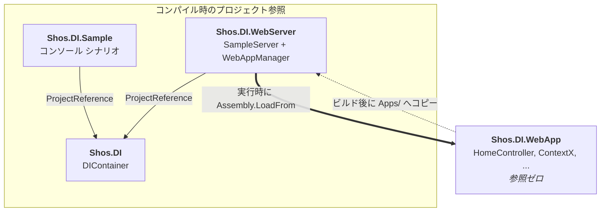
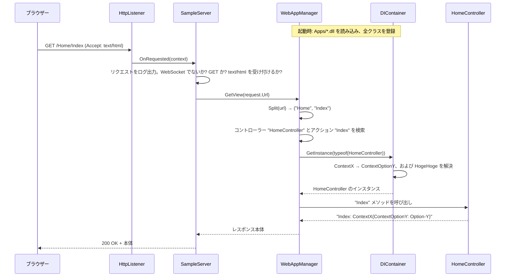

# Shos.DI

> English version: [README.md](README.md)

**Shos.DI** は、DI (Dependency Injection: 依存性の注入) の仕組みを理解するために、.NET 用の DI コンテナをゼロから実装したものです。実用的なコンテナと張り合うことを目的としたものではなく、「DI とは内部で何をやっているのか」を説明するためのコードです。

コンテナ本体はたった 1 ファイル — [`Shos.DI/DIContainer.cs`](Shos.DI/DIContainer.cs) — に収まっています。そしてこのソリューションでは、そのコンテナを使って小さな Web サーバーと小さな MVC アプリケーションを組み立てています。これにより、ASP.NET Core のような実際のフレームワークが、どこでサービス登録を行い、どこでコントローラーを生成し、どこでコンストラクター インジェクションを実行しているのかを、目で追えるようになっています。

---

## 目次

- [このリポジトリの目的](#このリポジトリの目的)
- [プロジェクト構成](#プロジェクト構成)
- [アーキテクチャ](#アーキテクチャ)
- [コンテナの仕組み](#コンテナの仕組み)
- [Shos.DI.Sample — コンソール アプリでの DI](#shosdisample--コンソール-アプリでの-di)
- [Shos.DI.WebServer と Shos.DI.WebApp — ミニチュア版 ASP.NET Core](#shosdiwebserver-と-shosdiwebapp--ミニチュア版-aspnet-core)
- [はじめに](#はじめに)
- [各プロジェクトの実行方法](#各プロジェクトの実行方法)
- [使用技術](#使用技術)
- [制限事項](#制限事項)
- [作者](#作者)
- [ライセンス](#ライセンス)

---

## このリポジトリの目的

ASP.NET Core で、次のようなコントローラーを書いたとします。

```csharp
public class HomeController(MyDbContext context, IClock clock) : Controller
{
    // ...
}
```

このとき、誰かがこのコンストラクターを覗き込み、「`MyDbContext` と `IClock` が必要だ」と判断し、それらのオブジェクトを (さらに *その* 依存関係も再帰的に辿りながら) 生成し、そのうえでようやくコントローラーを生成しています。この「誰か」が DI コンテナであり、フレームワークはリクエストごとにこれを呼び出しています。

Shos.DI は、その仕組みを約 130 行の C# で実装しています。そのうえで手書きの Web サーバーに組み込むことで、*HTTP リクエスト → ルーティング → コントローラーの型 → コンストラクター インジェクション → アクションの呼び出し → HTTP レスポンス* という一連の流れ全体を、フレームワークの魔法に遮られることなく観察できるようにしています。

---

## プロジェクト構成

| プロジェクト | 種類 | 役割 |
| --- | --- | --- |
| [**Shos.DI**](Shos.DI) | クラス ライブラリ | DI コンテナ本体。リフレクションによる型の登録と、再帰的なコンストラクター インジェクション。他への依存は一切ありません。 |
| [**Shos.DI.Sample**](Shos.DI.Sample) | コンソール アプリ | コンテナを直接使う 4 つの短いシナリオ。API を理解する最短ルートです。 |
| [**Shos.DI.WebServer**](Shos.DI.WebServer) | コンソール アプリ (サーバー) | `HttpListener` 上に構築した最小構成の HTTP サーバーと、最小構成の MVC 風ディスパッチャー。Kestrel + ルーティング + コントローラー生成の役割を担います。 |
| [**Shos.DI.WebApp**](Shos.DI.WebApp) | クラス ライブラリ (プラグイン) | サンプルの「Web アプリケーション」。コントローラーとその依存関係のみで構成され、`Shos.DI.WebServer` から **実行時に** 読み込まれます。 |
| [**Shos.DI.Tests**](Shos.DI.Tests) | xUnit テスト プロジェクト | コンテナの挙動 (ライフタイム、明示的な引数、コンストラクターの選択、循環依存の検出、スレッド セーフ) を固定する単体テスト。 |

---

## アーキテクチャ



この図で注目すべきなのは、そこに **描かれていないもの** です。`Shos.DI.WebApp` はプロジェクト参照を 1 つも持っていません — `Shos.DI` すら参照していないのです。コンテナのこともサーバーのことも何も知らない、ただのクラス ライブラリです。サーバーは実行時に `Apps` フォルダーを走査して `.dll` を見つけ出します。これはプラグイン ホスト (あるいは、アプリケーション アセンブリを読み込むフレームワーク) がやっていることと同じです。

これが Web サンプルの最大の学びどころです。すなわち、**アプリケーションは DI コンテナの存在を知らなくてよい**ということ。アプリはコンストラクターで必要なものを宣言するだけで、あとはホストが面倒を見ます。

---

## コンテナの仕組み

以下の内容はすべて [`Shos.DI/DIContainer.cs`](Shos.DI/DIContainer.cs) にあります。

### 公開 API

```csharp
public class DIContainer
{
    // コンテナが生成してよい型として登録する。
    // インターフェイス、抽象クラス、オープン ジェネリック型は ArgumentException で拒否される。
    public void Register<T>();
    public void Register(Type type);
    public bool Register(string typeName);                  // 型名による遅延バインディング

    // 依存関係を再帰的に組み立てながらインスタンスを解決する。
    public T? GetInstance<T>() where T : class;
    public object? GetInstance(Type type);
    public object? GetInstance(string typeName);            // 型名による遅延バインディング

    // コンストラクター引数を自分で渡して、新しいインスタンスを生成する。
    public T? GetInstance<T>(params object?[] parameters) where T : class;
    public object? GetInstance(Type type, params object?[] parameters);
    public object? GetInstance(string typeName, params object?[] parameters);
}
```

### 依存関係の解決アルゴリズム

コンテナの心臓部は `Resolve` です。`GetInstance(Type)` はこれをロックの内側で呼び出します。

```csharp
object? Resolve(Type type, HashSet<Type> resolving)
{
    if (!typeInformations.TryGetValue(type, out var typeInformation))
        return type.GetInstance();                                  // (5) 未登録: 引数なしコンストラクターのみ

    if (typeInformation.Instance is not null)
        return typeInformation.Instance;                            // (1) 登録済み: コンテナごとに 1 インスタンス

    if (!resolving.Add(type))
        throw new InvalidOperationException(/* ... */);             // (6) 循環依存

    try {
        foreach (var constructor in typeInformation.Constructors) { // (2) 引数の多い順
            var parameters = constructor.GetParameters().Select(parameter => Resolve(parameter.ParameterType, resolving)).ToArray(); // (3) 再帰!
            if (parameters.Any(parameter => parameter is null))
                continue;                                           // (4) 満たせない — 次を試す
            return typeInformation.Instance = constructor.Invoke(parameters);
        }
        return null;
    } finally {
        resolving.Remove(type);
    }
}
```

順を追って見ていきます。

1. **キャッシュの参照。** 登録された型は一度だけ生成され、その `TypeInformation` にキャッシュされます。つまり 1 つのコンテナの中ではシングルトンです。登録済みの依存先も同じくシングルトンになり、それを必要とするすべての型で共有されます。
2. **コンストラクターの列挙。** すべての public コンストラクターが候補です。`Type.GetConstructors()` で一度だけ取得し、引数の多い順に並べ替えてキャッシュします。
3. **再帰的な解決。** 各パラメーターの型は、もう一度 `Resolve` を呼ぶことで解決されます。これによって、平坦な `Register` 呼び出しの並びが、完全なオブジェクト グラフへと変わります。
4. **穏やかなフォールバック。** どれか 1 つでもパラメーターを生成できなければ、そのコンストラクターは飛ばして次を試します。実用的なコンテナが採用している「引数を満たせる最も引数の多いコンストラクターを選ぶ」というルールです。
5. **未登録の型。** 一度も登録されていない型にも、1 回だけチャンスがあります。`Type.GetConstructor(Type.EmptyTypes)?.Invoke([])`、つまり引数なしでの生成で、毎回新しいインスタンスになります。コンソール サンプルの `Coo` を見てください — 一度も登録されていないのに生成されます。`Boo2` が必要とし、かつ既定のコンストラクターを持っているからです。
6. **循環依存の検出。** 生成中の型を追跡しており、生成が終わる前に同じ型がもう一度要求されると、循環を示す `InvalidOperationException` (例: `Cycle1 -> Cycle2 -> Cycle1`) を投げます。スタック オーバーフローするまで再帰することはありません。

### コンストラクター引数を自分で渡す

`GetInstance(type, parameters)` は何も解決しません。渡された引数を受け取れる public コンストラクターのうち最も引数の多いものを選んで呼び出すだけです。派生型の引数は基底型のパラメーターに一致し、`null` は任意の参照型パラメーターに一致します。結果は **常に新しいインスタンス** で、キャッシュされることはありません。そのため、渡した引数が黙って無視されることはなく、`GetInstance(type)` が作るシングルトンにも影響しません。

### スレッド セーフ

登録と解決は単一のロックを通るため、1 つのコンテナを複数の呼び出し元から同時に使っても安全です。Web サーバーは、まさにこの使い方で HTTP リクエストを並行に処理しています。

### 型名による解決

```csharp
static Type? ToType(string typeName)
    => AppDomain.CurrentDomain.GetAssemblies().Select(assembly => assembly.GetType(typeName))
                                              .FirstOrDefault(type => type is not null);
```

この小さなヘルパーが、`Register("Foo")` や `GetInstance("Shos.DI.WebApp.HomeController")` を成立させています。読み込み済みのすべてのアセンブリから、名前の一致する型を探します — 直前に動的に読み込まれたアセンブリも含めてです。同じ完全修飾名の型が複数の読み込み済みアセンブリにある場合は、最初に見つかったものが使われます。そのため Web サーバーは、すでに手元にあるコントローラーの `Type` を使って `GetInstance(Type)` を呼び出しています。

---

## Shos.DI.Sample — コンソール アプリでの DI

[`Shos.DI.Sample/Program.cs`](Shos.DI.Sample/Program.cs) では、小さな依存関係グラフを定義しています。

```
Foo(Boo2, Boo3)
 ├─ Boo2(Coo)
 │   └─ Coo()
 └─ Boo3(Boo1)
     └─ Boo1()
```

各コンストラクターが自分の名前を出力するようになっているため、コンソール出力がそのまま解決順序のトレースになります。

**Case 1 — ジェネリック型引数による解決。** 部品を登録して、ルートを要求します。

```csharp
var container = new DIContainer();

container.Register<Boo1>();
container.Register<Boo2>();
container.Register<Boo3>();
container.Register<Foo>();

var foo = container.GetInstance<Foo>();   // Boo2, Boo3, Coo, Boo1 がすべて自動生成される
```

**Case 2 — 型名による解決。** 同じことを、完全に遅延バインドで行います。

```csharp
container.Register(nameof(Foo));
var foo = container.GetInstance(nameof(Foo));
```

**Case 3・Case 4 — 引数を自分で渡す。** 登録するのは `Foo` だけで、その依存関係は直接渡します。コンテナは一致するコンストラクターを選び、呼び出すたびに新しい `Foo` を生成するだけです。

```csharp
container.Register<Foo>();
var foo = container.GetInstance<Foo>(new Boo2(new Coo()), new Boo3(new Boo1()));
```

4 つのケースはすべて同じグラフを生成します。それがまさに要点です — *やり方* は変わっても、結果は変わりません。

```
■ Case 1.
Coo
Boo2(Coo)
Boo1
Boo3(Boo1)
Foo(Boo2, Boo3)
Foo
```

深さ優先の順序になっていることに注目してください。`Coo` は `Boo2` より先に生成されます。依存先が存在しないうちは `Boo2` を生成できないからです。

---

## Shos.DI.WebServer と Shos.DI.WebApp — ミニチュア版 ASP.NET Core

ここがこのリポジトリでじっくり読む価値のある部分です。この 2 つのプロジェクトは、わずか 3 ファイル・約 250 行で、ASP.NET Core のうち「多くの開発者が毎日使っているが、中身を覗くことはめったにない」部分を再実装しています。

### 対応関係

| ASP.NET Core | Shos.DI での相当物 | ファイル |
| --- | --- | --- |
| `WebApplication.Run()` とホストのライフタイム | `Program.Main` → `server.Start(...)` → `q` (または Ctrl+C) の入力待ち | [`Shos.DI.WebServer/Program.cs`](Shos.DI.WebServer/Program.cs) |
| Kestrel (HTTP サーバー) | `System.Net.HttpListener` をラップした `SampleServer` | [`Shos.DI.WebServer/Server.cs`](Shos.DI.WebServer/Server.cs) |
| ミドルウェア パイプライン | `ProcessRequest` — 明示的に並んだ処理の列 | [`Shos.DI.WebServer/Server.cs`](Shos.DI.WebServer/Server.cs) |
| リクエスト ログ出力のミドルウェア | `Log(request)` / `Log(response)` | [`Shos.DI.WebServer/Server.cs`](Shos.DI.WebServer/Server.cs) |
| 開発者例外ページ | `ReturnInternalError` — 500 と例外の内容を返す (Debug ビルドのみ) | [`Shos.DI.WebServer/Server.cs`](Shos.DI.WebServer/Server.cs) |
| アプリケーション パーツ / アセンブリの探索 | `Directory.GetFiles(appFolder, "*.dll")` + `Assembly.LoadFrom` (起動時に 1 回) | [`Shos.DI.WebServer/WebAppManager.cs`](Shos.DI.WebServer/WebAppManager.cs) |
| `builder.Services.Add…` (サービス登録) | `foreach (var type in types) container.Register(type);` | [`Shos.DI.WebServer/WebAppManager.cs`](Shos.DI.WebServer/WebAppManager.cs) |
| `{controller=Home}/{action=Index}` のルート テンプレート | `Split(Uri)` | [`Shos.DI.WebServer/WebAppManager.cs`](Shos.DI.WebServer/WebAppManager.cs) |
| コントローラーの生成 (コンストラクター インジェクション) | `container.GetInstance(controllerType)` | [`Shos.DI.WebServer/WebAppManager.cs`](Shos.DI.WebServer/WebAppManager.cs) |
| アクションの選択・呼び出しと結果のレンダリング | `GetAction` + `action.Invoke(controller, [])` → レスポンス本体 | [`Shos.DI.WebServer/WebAppManager.cs`](Shos.DI.WebServer/WebAppManager.cs) |
| 自分の MVC アプリケーション アセンブリ | `Shos.DI.WebApp` | [`Shos.DI.WebApp/HomeController.cs`](Shos.DI.WebApp/HomeController.cs) |

### リクエスト処理の流れ



### 1. ホスティング — `Program.cs`

```csharp
static void Main()
{
    try {
        using var server = new SampleServer();
        server.Start("http://+:8080/", "https://+:44301/");
        Wait();                       // 'q' が押されるまでブロック
    } catch (Exception e) {
        Console.WriteLine($"Error: {e}");
    }
}
```

これは `WebApplication.Run()` を本質だけに削ぎ落としたものです。サーバーを生成し、URL プレフィックスにバインドし、あとはプロセスを生かし続けるだけ。`+` は `HttpListener` のワイルドカード ホスト指定で、ASP.NET Core の URL 設定における `http://*:8080` に相当します。

### 2. HTTP サーバー — `Server.cs`

`SampleServer` は `HttpListener`、`WebAppManager` (サーバーと一緒に 1 回だけ生成)、そして非同期の受け付けループを持っています。リクエストが届くたびに、すぐに次の受け付けを再開するため、リクエストは並行して処理されます。

```csharp
void OnRequested(IAsyncResult result)
{
    HttpListenerContext context;
    try {
        if (!listener.IsListening)
            return;
        context = listener.EndGetContext(result);
        listener.BeginGetContext(OnRequested, null);   // すぐに次のリクエストを受け付ける
    } catch (Exception e) when (e is HttpListenerException or ObjectDisposedException or InvalidOperationException) {
        return; // リスナーは停止済み
    }
    // ...
}
```

`ProcessRequest` がパイプラインです。ASP.NET Core であれば `app.Use…` のデリゲートを連鎖させるところですが、ここでは各段階が単なる逐次的な文として並んでいます。そのおかげで、パイプラインの「かたち」が非常に見やすくなっています。

```csharp
void ProcessRequest(HttpListenerContext context)
{
    var request  = context.Request ;
    var response = context.Response;
    Log(request);                                                   // ログ出力段階

    if (request.IsWebSocketRequest) {                               // プロトコルのフィルター
        Respond(response, HttpStatusCode.BadRequest, "WebSocket is not supported.");
        return;
    }
    if (!CanAccept(HttpMethod.Get, request.HttpMethod)) {           // メソッドのフィルター
        response.AddHeader("Allow", HttpMethod.Get.Method);
        Respond(response, HttpStatusCode.MethodNotAllowed, "Method Not Allowed.");
        return;
    }

    var content = GetContent(request);                              // エンドポイント段階 (MVC)
    if (content is null)
        Respond(response, HttpStatusCode.NotFound, "Not Found.");
    else
        Respond(response, HttpStatusCode.OK, content, "text/html");
}
```

どの分岐も最後は `Respond` に行き着きます。`Respond` はステータス コードと `Content-Type` を設定し、本文を UTF-8 (BOM なし) で書き込み、レスポンスを閉じてからログに出力します。そのため、応答されないまま放置されるリクエストはありません。

コンテンツ ネゴシエーションは 1 行です。クライアントが HTML を受け付ける場合にだけ、サーバーはリクエストを MVC 層に渡します。

```csharp
protected virtual string? GetContent(HttpListenerRequest request)
    => AcceptsHtml(request) && request.Url is not null
       ? webAppManager.GetView(request.Url)
       : null;
```

`AcceptsHtml` は `text/html`、`text/*`、`*/*` (`;q=0.9` のようなパラメーターは無視) を受け付けるほか、`Accept` ヘッダーがまったくないリクエストも受け付けます。そのため、ブラウザーでもそのままの `curl` でも動作します。たとえば `application/json` だけを求めるクライアントには 404 が返ります。

### 3. ルーティング・登録・生成 — `WebAppManager.cs`

このクラス 1 つで、ASP.NET Core では多くの部品に分かれている 3 つの責務を担っています。まずはコンストラクターでの **探索と登録** です。これはサーバーの起動時に 1 回だけ実行されます。

```csharp
public WebAppManager()
{
    const string appFolderName = "Apps";

    var appFolder = Path.Combine(AppContext.BaseDirectory, appFolderName);
    var types     = Directory.GetFiles(appFolder, "*.dll")
                             .Select(Assembly.LoadFrom)
                             .SelectMany(assembly => assembly.GetTypes())
                             .Where(type => type.IsClass && !type.IsAbstract && !type.ContainsGenericParameters)
                             .ToList();
    foreach (var type in types)
        container.Register(type);                 // すべてのクラスが注入可能になる

    controllerTypes = types.Where(type => type.Name.EndsWith(controllerSuffix, StringComparison.Ordinal)).ToList();
}
```

これは意図的に無差別であることに注目してください。`Apps` 内の *すべての* アセンブリの *すべての* 具象クラスが登録されます。実際のコンテナでは明示的な登録が必要です (`builder.Services.AddScoped<IClock, SystemClock>()`)。何でも登録してしまうのは、このサンプルを読みやすく保つための近道です。`Apps` フォルダーは実行ファイルの隣 (`AppContext.BaseDirectory`) から探すので、サーバーをどのディレクトリから起動しても構いません。

次に **ルーティング**。`{controller=Home}/{action=Index}` という規約を、URL のパスの分割で実装しています。

```csharp
static (string controllerName, string actionName) Split(Uri url)
{
    // "http://localhost:8080/Home/Index?x=1" → AbsolutePath "/Home/Index" → ["Home", "Index"]
    var segments = url.AbsolutePath.Split('/', StringSplitOptions.RemoveEmptyEntries)
                                   .Select(Uri.UnescapeDataString)
                                   .ToArray();
    return (segments.ElementAtOrDefault(0) ?? defaultController, segments.ElementAtOrDefault(1) ?? defaultAction);
}
```

ASP.NET Core の既定のルートと同じく、省略されたセグメントは `Home` と `Index` で補われ、クエリ文字列は無視され、コントローラー名とアクション名は大文字小文字を区別せずに照合されます。

最後に **生成と呼び出し** — 実際に DI が行われる段階です。

```csharp
string? GetView(string controllerName, string actionName)
{
    var controllerType = controllerTypes.FirstOrDefault(type => string.Equals(type.Name, $"{controllerName}{controllerSuffix}", StringComparison.OrdinalIgnoreCase));
    if (controllerType is null)
        return null;                                   // → 404

    var action = GetAction(controllerType, actionName);
    if (action is null)
        return null;                                   // → 404

    var controller = container.GetInstance(controllerType);   // ← コンストラクター インジェクション
    return controller is null ? null : action.Invoke(controller, []) as string;   // ← 戻り値がレスポンス本体になる
}
```

何をアクションとみなすかは `GetAction` が決めます。コントローラー自身が宣言した、引数のない public インスタンス メソッドで、戻り値が `string` のものだけがアクションです。`ToString` や `GetType` のような継承したメンバー、オーバーライド、プロパティのアクセサー、static メソッドには URL から到達できません。ASP.NET Core がどのメソッドをアクションとみなすかを決めているルールの、リフレクションによる簡易版です。

ASP.NET Core MVC の 3 つの規約が、ここで目に見えています。`…Controller` というサフィックス、アクション名が public メソッドに対応すること、そしてアクションの戻り値がレスポンスになること。さらに `container.GetInstance(...)` という 1 回の呼び出しが、フレームワークが通常コントローラー生成のために行っているすべてを置き換えています。

### 4. アプリケーション — `Shos.DI.WebApp/HomeController.cs`

```csharp
namespace Shos.DI.WebApp;

public class HomeController(ContextX context, HogeHoge hogeHoge)
{
    public string Index()  => $"{nameof(Index)}: {context}";
    public string Detail() => $"{nameof(Detail)}: {context}";
}

public class HogeHoge
{}

public class ContextX(ContextOptionY option)
{
    public override string ToString() => $"{nameof(ContextX)}({nameof(ContextOptionY)}: {option})";
}

public class ContextOptionY
{
    public override string ToString() => "Option-Y";
}
```

これがアプリケーションの全体です。いくつか押さえておきたい点があります。

- **コンテナも基底クラスも属性も不要。** `HomeController` は `: Controller` を継承しておらず、`[Route]` も付いておらず、`Shos.DI` を参照してもいません。(プライマリ) コンストラクターで必要なものを宣言しているだけです。これが「コンテナを呼ぶのではなく、コンテナに呼ばせる」という原則であり、このプロジェクトが参照ゼロでビルドできる理由です。
- **入れ子になった依存関係。** `HomeController` は `ContextX` を必要とし、`ContextX` は `ContextOptionY` を必要とします。`new ContextOptionY()` と書く箇所はどこにもありません — コンテナが連鎖を辿ります。実際のアプリにおける `DbContext` ← `DbContextOptions` と同じ構図です。
- **使われない依存関係も生成される。** `hogeHoge` は注入されていますが使われていません。解決がコンストラクターのシグネチャだけで決まっていることを確認できる、分かりやすい例になっています。
- **コピーによる配置。** `Shos.DI.WebApp.csproj` には、ビルド後に出力をサーバーの `Apps` フォルダーへコピーするステップがあります。MSBuild の `Copy` タスクを使っているので、どの OS でも動作します。

  ```xml
  <Target Name="CopyToServerApps" AfterTargets="Build">
    <ItemGroup>
      <AppFiles Include="$(OutDir)**\*" />
    </ItemGroup>
    <Copy SourceFiles="@(AppFiles)"
          DestinationFolder="$(MSBuildThisFileDirectory)..\Shos.DI.WebServer\bin\$(Configuration)\$(TargetFramework)\Apps\%(RecursiveDir)"
          SkipUnchangedFiles="true" />
  </Target>
  ```

  この `Apps` フォルダーが 2 つのプロジェクト間の唯一の契約であり、両者を結びつけている唯一のものです。

したがって `GET /Home/Index` は次を返します。

```
Index: ContextX(ContextOptionY: Option-Y)
```

…そしてこの文字列は、ルーティング、3 階層のオブジェクト グラフのコンテナによる解決、リフレクションによるアクション呼び出し、レスポンス パイプラインを通り抜けてきたものです。しかもその全工程が、一度に読み切れる分量のコードとして目の前にあります。

---

## はじめに

### 前提条件

- [.NET 10 SDK](https://dotnet.microsoft.com/download/dotnet/10.0) — すべてのプロジェクトが `net10.0` を対象にしています。
- ソリューション全体のビルドとテストは、Windows・Linux・macOS のいずれでも実行できます。
- `Shos.DI.WebServer` の実行には **Windows** を推奨します。`+` ワイルドカードのプレフィックスで `HttpListener` を使うには、管理者権限か URL ACL の予約が必要なため、このプロジェクトには `requireAdministrator` を要求する [`app.manifest`](Shos.DI.WebServer/app.manifest) が含まれています。

### クローン

```bash
git clone https://github.com/Fujiwo/Shos.DI.git
cd Shos.DI
```

### ビルド

```bash
dotnet build Shos.DI.sln
dotnet test Shos.DI.sln
```

[`Directory.Build.props`](Directory.Build.props) によってソリューション全体で静的解析が有効になっています (`EnableNETAnalyzers`、`AnalysisLevel = latest-Minimum`)。そのため、通常のビルドでアナライザーの警告が表示されます。

---

## 各プロジェクトの実行方法

### Shos.DI.Sample

```bash
dotnet run --project Shos.DI.Sample
```

[前述](#shosdisample--コンソール-アプリでの-di)の 4 つのシナリオが出力されます。

### Shos.DI.WebServer + Shos.DI.WebApp

`dotnet build` を実行すると `Shos.DI.WebApp` のビルド後のコピーも実行されるため、サーバーの隣にはすでに `Apps/Shos.DI.WebApp.dll` が配置されています。サーバーは自分の実行ファイルを基準に `Apps` を探すので、どこから起動しても構いません。

Windows では、**管理者として実行した** コマンド プロンプトから:

```cmd
dotnet build Shos.DI.sln
Shos.DI.WebServer\bin\Debug\net10.0\Shos.DI.WebServer.exe
```

Linux / macOS では:

```bash
dotnet build Shos.DI.sln
./Shos.DI.WebServer/bin/Debug/net10.0/Shos.DI.WebServer
```

コンソールには次のように表示されます。

```
Listening...
http://+:8080/
https://+:44301/
Press 'q' to quit.
```

ブラウザーで次の URL を開きます。

| URL | レスポンス |
| --- | --- |
| <http://localhost:8080/Home/Index> | `Index: ContextX(ContextOptionY: Option-Y)` |
| <http://localhost:8080/Home/Detail> | `Detail: ContextX(ContextOptionY: Option-Y)` |
| <http://localhost:8080/> | `/Home/Index` と同じ (既定のコントローラーとアクション) |
| <http://localhost:8080/home/index?x=1> | `/Home/Index` と同じ (大文字小文字を区別せず、クエリ文字列は無視) |
| <http://localhost:8080/Home/Nope> | `Not Found.` (404 — 該当するアクションなし) |
| <http://localhost:8080/Home/ToString> | `Not Found.` (404 — アクションではない) |
| <http://localhost:8080/Nope/Index> | `Not Found.` (404 — 該当するコントローラーなし) |

すべてのリクエストとレスポンスがヘッダーも含めてコンソールに出力されるので、パイプラインの動きを観察するのに便利です。

`curl` はそのままで動作します (`Accept: */*` を送るため)。`GET` 以外のメソッドには `405 Method Not Allowed` が返ります。

```bash
curl http://localhost:8080/Home/Index
curl -i -X POST http://localhost:8080/Home/Index
```

サーバーのコンソールで `q` を押すと終了します。標準入力がリダイレクトされている場合 (CI、コンテナ、`nohup` など) は、代わりに Ctrl+C を待ちます。

> **HTTPS について:** `https://+:44301/` プレフィックスは登録されますが、HTTPS リクエストを成功させるには、そのポートに TLS 証明書をバインドしておく必要があります (`netsh http add sslcert …`)。その設定を済ませていない場合は HTTP のエンドポイントを使ってください。

---

## 使用技術

- [.NET 10](https://dotnet.microsoft.com/download/dotnet/10.0) (`net10.0`)
- C# 14 — 拡張メンバー (拡張プロパティを含む `extension` ブロック)、`field` キーワード、`System.Threading.Lock` 型、ファイル スコープ名前空間、プライマリ コンストラクター、コレクション式 (`[]`、`[.. ]`)、null 許容参照型、暗黙的な using を使用
- `System.Reflection` — コンテナの仕組みのすべて
- `System.Net.HttpListener` — Web サーバーのトランスポート
- コンテナ、サンプル、Web サーバーではサードパーティ パッケージを一切使用していません (テスト プロジェクトのみ xUnit を使用)

---

## 制限事項

以下はすべて意図的なものです。Shos.DI が何を省いているかを知ることは、`Microsoft.Extensions.DependencyInjection` のような実用的なコンテナが何を提供しているのかを理解することの一部です。

- **インターフェイスと実装のマッピングがない。** 登録も解決も具体的な型に対して行います。`AddScoped<IClock, SystemClock>()` に相当する機能はありません。インターフェイスや抽象クラスを登録しようとすると `ArgumentException` になります。
- **ライフタイムは 1 種類だけ。** 登録された型はすべて、そのコンテナ内でシングルトンになります (未登録の型と、明示的な引数による生成は、常に新しいインスタンスになります)。Transient や Scoped の登録はなく、`IDisposable` の追跡も行いません。Web サンプルでは、コントローラーが 1 回だけ生成されて全リクエストで共有されることになります。ASP.NET Core ではリクエストごとに新しいコントローラーが生成されます。
- **失敗が静かである。** 解決できない依存関係は、説明的な例外ではなく `null` になります (循環依存だけは例外を投げます)。
- **Web サーバー**は `GET` のみを処理します。ビュー エンジンもなく (アクションはプレーンな文字列を返します)、モデル バインドも静的ファイルの配信もありません。

---

## 作者

Fujio Kojima: 日本のソフトウェア開発者

* Microsoft MVP for Development Tools - Visual C# (Jul. 2005 - Dec. 2014)
* Microsoft MVP for .NET (Jan. 2015 - Oct. 2015)
* Microsoft MVP for Visual Studio and Development Technologies (Nov. 2015 - Jun. 2018)
* Microsoft MVP for Developer Technologies (Nov. 2018 - Jun. 2025)
* [MVP プロフィール](https://mvp.microsoft.com/en-us/PublicProfile/21482 "MVP Profile")
* [ブログ](http://wp.shos.info "ブログ")
* [Web サイト](http://www.shos.info "Web サイト")
* [Twitter](https://twitter.com/Fujiwo)
* [Instagram](https://www.instagram.com/fujiwo/)

## ライセンス

このプロジェクトは MIT ライセンスの下で公開されています。詳細は [LICENSE.txt](LICENSE.txt) を参照してください。

---

**English version:** [README.md](README.md)
