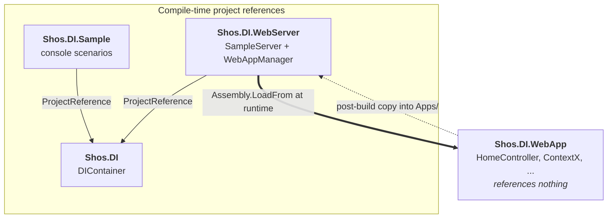
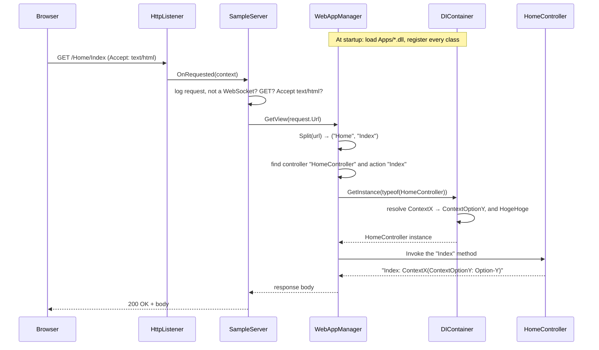

# Shos.DI

[](https://github.com/Fujiwo/Shos.DI/actions/workflows/build.yml)

**Shos.DI** is a from-scratch Dependency Injection (DI) container for .NET, written to *explain* how DI works rather than to compete with production containers.

The whole container is a single file — [`Shos.DI/DIContainer.cs`](Shos.DI/DIContainer.cs) — and the solution then uses it to build a miniature web server and a miniature MVC application, so you can see exactly where a real framework like ASP.NET Core would perform service registration, controller activation, and constructor injection.

> 日本語版は [README.jp.md](README.jp.md) をご覧ください。

---

## Table of Contents

- [Why this repository exists](#why-this-repository-exists)
- [Projects](#projects)
- [Architecture](#architecture)
- [How the container works](#how-the-container-works)
- [Shos.DI.Sample — DI in a console app](#shosdisample--di-in-a-console-app)
- [Shos.DI.WebServer and Shos.DI.WebApp — a miniature ASP.NET Core](#shosdiwebserver-and-shosdiwebapp--a-miniature-aspnet-core)
- [Tests](#tests)
- [Getting Started](#getting-started)
- [Running each project](#running-each-project)
- [Built With](#built-with)
- [Limitations](#limitations)
- [Authors](#authors)
- [License](#license)

---

## Why this repository exists

When you write an ASP.NET Core controller like this:

```csharp
public class HomeController(MyDbContext context, IClock clock) : Controller
{
    // ...
}
```

…something has to look at that constructor, work out that it needs a `MyDbContext` and an `IClock`, build those objects (recursively building *their* dependencies), and only then create the controller. That "something" is the DI container, and the framework calls into it for every request.

Shos.DI implements that mechanism in about 130 lines of C#, then wires it into a hand-written web server so you can watch the whole path — *HTTP request → route → controller type → constructor injection → action invocation → HTTP response* — without any framework magic in the way.

---

## Projects

| Project | Kind | Role |
| --- | --- | --- |
| [**Shos.DI**](Shos.DI) | Class library | The DI container itself. Reflection-based type registration and recursive constructor injection. No other dependencies. |
| [**Shos.DI.Sample**](Shos.DI.Sample) | Console app | Four short scenarios that exercise the container directly. The quickest way to understand the API. |
| [**Shos.DI.WebServer**](Shos.DI.WebServer) | Console app (server) | A minimal HTTP server built on `HttpListener`, plus a minimal MVC-style dispatcher. Plays the role of Kestrel + routing + controller activation. |
| [**Shos.DI.WebApp**](Shos.DI.WebApp) | Class library (plugin) | A sample "web application" — a controller and its dependency graph. Loaded **at runtime** by `Shos.DI.WebServer`. |
| [**Shos.DI.Tests**](Shos.DI.Tests) | xUnit test project | Unit tests that pin down the container's behaviour: lifetimes, constructor selection and fallback, explicit arguments, cycle detection, error propagation, argument validation, thread safety. See [Tests](#tests). |

---

## Architecture



The interesting part of this diagram is what is **missing**: `Shos.DI.WebApp` has *no* project reference — not even to `Shos.DI`. It is a plain class library that knows nothing about the container or the server. The server discovers it at runtime by scanning an `Apps` folder for `.dll` files, exactly the way a plugin host (or a framework loading your application assembly) would.

That is the central lesson of the web sample: **an application should not have to know that a DI container exists.** It just declares its dependencies in constructors; the host does the rest.

---

## How the container works

All of the following lives in [`Shos.DI/DIContainer.cs`](Shos.DI/DIContainer.cs).

### Public API

```csharp
public class DIContainer
{
    // Register a type so the container is allowed to construct it.
    // Only concrete classes can be registered: interfaces, abstract and static classes, value types
    // and open generic types are rejected with ArgumentException (closed generics such as List<int> are fine).
    // Registering a type again discards its cached instance.
    public void Register<T>();
    public void Register(Type type);
    public bool Register(string typeName);                  // late-bound, by type name

    // Resolve an instance, building its dependencies recursively.
    public T? GetInstance<T>() where T : class;
    public object? GetInstance(Type type);
    public object? GetInstance(string typeName);            // late-bound, by type name

    // Create a new instance from constructor arguments you supply yourself.
    public T? GetInstance<T>(params object?[] parameters) where T : class;
    public object? GetInstance(Type type, params object?[] parameters);
    public object? GetInstance(string typeName, params object?[] parameters);
}
```

### The resolution algorithm

`Resolve` is the heart of the container; `GetInstance(Type)` calls it under a lock:

```csharp
object? Resolve(Type type, HashSet<Type> resolving)
{
    if (!typeInformations.TryGetValue(type, out var typeInformation))
        return type.GetInstance();                                  // (5) unregistered: parameterless constructor only

    if (typeInformation.Instance is not null)
        return typeInformation.Instance;                            // (1) registered: one instance per container

    if (!resolving.Add(type))
        throw new InvalidOperationException(/* ... */);             // (6) circular dependency

    try {
        foreach (var constructor in typeInformation.Constructors) { // (2) greediest first
            var parameters = constructor.GetParameters().Select(parameter => Resolve(parameter.ParameterType, resolving)).ToArray(); // (3) recurse!
            if (parameters.Any(parameter => parameter is null))
                continue;                                           // (4) unsatisfiable — try the next one
            return typeInformation.Instance = constructor.Invoke(parameters);
        }
        return null;
    } finally {
        resolving.Remove(type);
    }
}
```

Step by step:

1. **Cache lookup.** A registered type is built once and cached in its `TypeInformation`, so it is a singleton within one container. Its registered dependencies are singletons too, and are shared by everything that needs them — even when two branches of the graph depend on the same type. Separate containers never share instances, and calling `Register` again for a type starts it over with an empty cache.
2. **Constructor enumeration.** Every public constructor is a candidate. They are discovered once via `Type.GetConstructors()`, sorted by parameter count (most first), and cached.
3. **Recursive resolution.** Each parameter type is resolved by calling `Resolve` again. This is what turns a flat list of `Register` calls into a full object graph.
4. **Graceful fallback.** If any parameter cannot be produced, that constructor is skipped and the next one is tried — the "greediest constructor that can be satisfied" rule real containers use. If no constructor can be satisfied (say, every one needs an interface or an `int`), the result is `null`, and nothing is cached, so the next request tries again.
5. **Unregistered types.** A type that was never registered still gets one chance: `Type.GetConstructor(Type.EmptyTypes)?.Invoke([])`, i.e. public parameterless construction — a new instance every time. Interfaces, value types such as `int`, and classes without a public parameterless constructor therefore resolve to `null`. Look at `Coo` in the console sample — it is never registered, yet it is created, because `Boo2` needs it and it has a default constructor.
6. **Cycle detection.** The types currently being built are tracked. If one is requested again before it is finished — including a type that asks for itself — an `InvalidOperationException` names the cycle (for example `Cycle1 -> Cycle2 -> Cycle1`) instead of recursing until the stack overflows. The `finally` block takes a type off the list even when its resolution fails, so a dependency that could not be built and is requested again later in the same graph is not mistaken for a cycle.

If a constructor itself throws, the exception is not swallowed: it reaches the caller wrapped in a `TargetInvocationException` (that is how `ConstructorInfo.Invoke` reports it), and no instance is cached.

### Supplying constructor arguments yourself

`GetInstance(type, parameters)` does not resolve anything. It picks the greediest public constructor whose parameters accept the given arguments — an argument of a derived type matches a base-type parameter, a boxed value matches its value-type parameter (`42` fits `int` and `int?`), and `null` matches any reference-type or `Nullable<T>` parameter but never a plain value type — and invokes it. If no constructor fits, the result is `null`. It works for unregistered types too. The result is **always a new instance** and is never cached, so the arguments you pass are never silently ignored, and the singleton that `GetInstance(type)` builds is not affected.

### Thread safety

Registration and resolution go through a single lock, so one container can safely be shared by concurrent callers — which is exactly what the web server does with its HTTP requests.

### Resolving types by name

```csharp
static Type? ToType(string typeName)
    => AppDomain.CurrentDomain.GetAssemblies().Select(assembly => assembly.GetType(typeName))
                                              .FirstOrDefault(type => type is not null);
```

This small helper is what makes `Register("Foo")` and `GetInstance("Shos.DI.WebApp.HomeController")` work. It searches every loaded assembly for a matching type name — including assemblies that were loaded dynamically a moment earlier. If several loaded assemblies contain a type with the same full name, the first one found wins — which is why the web server, which already holds the controller's `Type`, calls `GetInstance(Type)` instead.

---

## Shos.DI.Sample — DI in a console app

[`Shos.DI.Sample/Program.cs`](Shos.DI.Sample/Program.cs) defines a small dependency graph:

```
Foo(Boo2, Boo3)
 ├─ Boo2(Coo)
 │   └─ Coo()
 └─ Boo3(Boo1)
     └─ Boo1()
```

Every constructor prints its own name, so the console output *is* the trace of the resolution order.

**Case 1 — resolve by generic type argument.** Register the parts, ask for the root:

```csharp
var container = new DIContainer();

container.Register<Boo1>();
container.Register<Boo2>();
container.Register<Boo3>();
container.Register<Foo>();

var foo = container.GetInstance<Foo>();   // Boo2, Boo3, Coo, Boo1 all built automatically
```

**Case 2 — resolve by type name.** The same thing, entirely late-bound:

```csharp
container.Register(nameof(Foo));
var foo = container.GetInstance(nameof(Foo));
```

**Cases 3 and 4 — supply arguments yourself.** Only `Foo` is registered; its dependencies are handed in directly, so the container just picks the matching constructor and creates a new `Foo` on every call:

```csharp
container.Register<Foo>();
var foo = container.GetInstance<Foo>(new Boo2(new Coo()), new Boo3(new Boo1()));
```

All four cases produce the same graph, which is the point — the *how* changes, the result does not:

```
■ Case 1.
Coo
Boo2(Coo)
Boo1
Boo3(Boo1)
Foo(Boo2, Boo3)
Foo
```

Note the depth-first order: `Coo` is constructed before `Boo2`, because `Boo2` cannot exist until its dependency does.

---

## Shos.DI.WebServer and Shos.DI.WebApp — a miniature ASP.NET Core

This is the part of the repository worth reading slowly. Between them, these two projects re-implement — in three small files and about 250 lines — the pieces of ASP.NET Core that most developers use every day but rarely see the inside of.

### What maps to what

| ASP.NET Core | Shos.DI equivalent | File |
| --- | --- | --- |
| `WebApplication.Run()` and host lifetime | `Program.Main` → `server.Start(...)` → wait for `q` (or Ctrl+C) | [`Shos.DI.WebServer/Program.cs`](Shos.DI.WebServer/Program.cs) |
| Kestrel (the HTTP server) | `SampleServer` wrapping `System.Net.HttpListener` | [`Shos.DI.WebServer/Server.cs`](Shos.DI.WebServer/Server.cs) |
| The middleware pipeline | `ProcessRequest` — an explicit sequence of checks | [`Shos.DI.WebServer/Server.cs`](Shos.DI.WebServer/Server.cs) |
| Request logging middleware | `Log(request)` / `Log(response)` | [`Shos.DI.WebServer/Server.cs`](Shos.DI.WebServer/Server.cs) |
| Developer exception page | `ReturnInternalError` — 500 plus the exception text (Debug builds only) | [`Shos.DI.WebServer/Server.cs`](Shos.DI.WebServer/Server.cs) |
| Application parts / assembly discovery | `Directory.GetFiles(appFolder, "*.dll")` + `Assembly.LoadFrom`, once at startup | [`Shos.DI.WebServer/WebAppManager.cs`](Shos.DI.WebServer/WebAppManager.cs) |
| `builder.Services.Add…` (service registration) | `foreach (var type in types) container.Register(type);` | [`Shos.DI.WebServer/WebAppManager.cs`](Shos.DI.WebServer/WebAppManager.cs) |
| The `{controller=Home}/{action=Index}` route template | `Split(Uri)` | [`Shos.DI.WebServer/WebAppManager.cs`](Shos.DI.WebServer/WebAppManager.cs) |
| Controller activation (constructor injection) | `container.GetInstance(controllerType)` | [`Shos.DI.WebServer/WebAppManager.cs`](Shos.DI.WebServer/WebAppManager.cs) |
| Action selection, invocation and result rendering | `GetAction` + `action.Invoke(controller, [])` → response body | [`Shos.DI.WebServer/WebAppManager.cs`](Shos.DI.WebServer/WebAppManager.cs) |
| Your MVC application assembly | `Shos.DI.WebApp` | [`Shos.DI.WebApp/HomeController.cs`](Shos.DI.WebApp/HomeController.cs) |

### The request pipeline



### 1. Hosting — `Program.cs`

```csharp
static void Main()
{
    try {
        using var server = new SampleServer();
        server.Start("http://+:8080/", "https://+:44301/");
        Wait();                       // block until the user presses 'q'
    } catch (Exception e) {
        Console.WriteLine($"Error: {e}");
    }
}
```

This is `WebApplication.Run()` stripped to its essence: create the server, bind it to some URL prefixes, then keep the process alive. `+` is `HttpListener`'s wildcard host, the counterpart of `http://*:8080` in ASP.NET Core's URL configuration.

### 2. The HTTP server — `Server.cs`

`SampleServer` owns an `HttpListener`, a `WebAppManager` (created once, together with the server) and an asynchronous accept loop. Each time a request arrives it immediately re-arms itself, so requests can overlap:

```csharp
void OnRequested(IAsyncResult result)
{
    HttpListenerContext context;
    try {
        if (!listener.IsListening)
            return;
        context = listener.EndGetContext(result);
        listener.BeginGetContext(OnRequested, null);   // accept the next request right away
    } catch (Exception e) when (e is HttpListenerException or ObjectDisposedException or InvalidOperationException) {
        return; // The listener has been stopped.
    }
    // ...
}
```

`ProcessRequest` is the pipeline. Where ASP.NET Core would chain `app.Use…` delegates, here the stages are just sequential statements — which makes the shape of a pipeline unusually easy to see:

```csharp
void ProcessRequest(HttpListenerContext context)
{
    var request  = context.Request ;
    var response = context.Response;
    Log(request);                                                   // logging stage

    if (request.IsWebSocketRequest) {                               // protocol filter
        Respond(response, HttpStatusCode.BadRequest, "WebSocket is not supported.");
        return;
    }
    if (!CanAccept(HttpMethod.Get, request.HttpMethod)) {           // method filter
        response.AddHeader("Allow", HttpMethod.Get.Method);
        Respond(response, HttpStatusCode.MethodNotAllowed, "Method Not Allowed.");
        return;
    }

    var content = GetContent(request);                              // endpoint stage (MVC)
    if (content is null)
        Respond(response, HttpStatusCode.NotFound, "Not Found.");
    else
        Respond(response, HttpStatusCode.OK, content, "text/html");
}
```

Every branch ends in `Respond`, which sets the status code and `Content-Type`, writes the body as UTF-8 (without a BOM), closes the response and logs it — so no request is ever left hanging.

Content negotiation is a single line — the server only hands a request to the MVC layer if the client accepts HTML:

```csharp
protected virtual string? GetContent(HttpListenerRequest request)
    => AcceptsHtml(request) && request.Url is not null
       ? webAppManager.GetView(request.Url)
       : null;
```

`AcceptsHtml` accepts `text/html`, `text/*` and `*/*` (parameters such as `;q=0.9` are ignored), as well as a request with no `Accept` header at all. Browsers and plain `curl` therefore both work; a client that asks only for, say, `application/json` gets a 404.

### 3. Routing, registration, and activation — `WebAppManager.cs`

This single class covers three responsibilities that ASP.NET Core splits across many. First, **discovery and registration** in the constructor, which runs once when the server starts:

```csharp
public WebAppManager()
{
    const string appFolderName = "Apps";

    var appFolder = Path.Combine(AppContext.BaseDirectory, appFolderName);
    var types     = Directory.GetFiles(appFolder, "*.dll")
                             .Select(Assembly.LoadFrom)
                             .SelectMany(assembly => assembly.GetTypes())
                             .Where(type => type.IsClass && !type.IsAbstract && !type.ContainsGenericParameters)
                             .ToList();
    foreach (var type in types)
        container.Register(type);                 // every class becomes injectable

    controllerTypes = [.. types.Where(type => type.Name.EndsWith(controllerSuffix, StringComparison.Ordinal))];
}
```

Notice that this is deliberately indiscriminate: *every* concrete class in *every* assembly in `Apps` is registered. Real containers require you to be explicit (`builder.Services.AddScoped<IClock, SystemClock>()`); registering everything is the shortcut that lets this sample stay readable. The `Apps` folder is looked up next to the executable (`AppContext.BaseDirectory`), so it does not matter which directory you start the server from.

Second, **routing**. The `{controller=Home}/{action=Index}` convention, implemented by splitting the URL path:

```csharp
static (string controllerName, string actionName) Split(Uri url)
{
    // "http://localhost:8080/Home/Index?x=1" → AbsolutePath "/Home/Index" → ["Home", "Index"]
    var segments = url.AbsolutePath.Split('/', StringSplitOptions.RemoveEmptyEntries)
                                   .Select(Uri.UnescapeDataString)
                                   .ToArray();
    return (segments.ElementAtOrDefault(0) ?? defaultController, segments.ElementAtOrDefault(1) ?? defaultAction);
}
```

As with ASP.NET Core's default route, missing segments fall back to `Home` and `Index`, the query string is ignored, and controller and action names are matched case-insensitively.

Third, **activation and invocation** — the step where DI actually happens:

```csharp
string? GetView(string controllerName, string actionName)
{
    var controllerType = controllerTypes.FirstOrDefault(type => string.Equals(type.Name, $"{controllerName}{controllerSuffix}", StringComparison.OrdinalIgnoreCase));
    if (controllerType is null)
        return null;                                   // → 404

    var action = GetAction(controllerType, actionName);
    if (action is null)
        return null;                                   // → 404

    var controller = container.GetInstance(controllerType);   // ← constructor injection
    return controller is null ? null : action.Invoke(controller, []) as string;   // ← the return value is the response body
}
```

`GetAction` decides what counts as an action: a public, parameterless instance method that the controller declares itself and that returns a `string`. Inherited members such as `ToString` or `GetType`, overrides, property accessors and static methods cannot be reached from a URL — a reflection-based counterpart of the rules ASP.NET Core uses to decide which methods are actions.

Three conventions of ASP.NET Core MVC are visible here: the `…Controller` suffix, the action name mapping to a public method, and the action's return value becoming the response. And `container.GetInstance(...)` is the one call that replaces everything the framework normally does to build a controller.

### 4. The application — `Shos.DI.WebApp/HomeController.cs`

```csharp
namespace Shos.DI.WebApp;

public class HomeController(ContextX context, HogeHoge hogeHoge)
{
    public string Index()  => $"{nameof(Index)}: {context}";
    public string Detail() => $"{nameof(Detail)}: {context}";
}

public class HogeHoge
{}

public class ContextX(ContextOptionY option)
{
    public override string ToString() => $"{nameof(ContextX)}({nameof(ContextOptionY)}: {option})";
}

public class ContextOptionY
{
    public override string ToString() => "Option-Y";
}
```

That is the entire application. A few things are worth pointing out:

- **No container, no base class, no attributes.** `HomeController` is not `: Controller`, has no `[Route]`, and does not reference `Shos.DI`. It only declares what it needs in its (primary) constructor. This is the "don't call the container, let the container call you" principle, and it is why the project compiles with zero references.
- **Nested dependencies.** `HomeController` needs `ContextX`, which needs `ContextOptionY`. Nobody ever writes `new ContextOptionY()` — the container walks the chain. Compare `DbContext` ← `DbContextOptions` in a real app.
- **Unused dependencies still get built.** `hogeHoge` is injected and ignored, which is a handy way to see that resolution is driven purely by the constructor signature.
- **Deployment by copy.** `Shos.DI.WebApp.csproj` has an after-build step that copies its output into the server's `Apps` folder. It uses MSBuild's `Copy` task, so it works on every OS:

  ```xml
  <Target Name="CopyToServerApps" AfterTargets="Build">
    <ItemGroup>
      <AppFiles Include="$(OutDir)**\*" />
    </ItemGroup>
    <Copy SourceFiles="@(AppFiles)"
          DestinationFolder="$(MSBuildThisFileDirectory)..\Shos.DI.WebServer\bin\$(Configuration)\$(TargetFramework)\Apps\%(RecursiveDir)"
          SkipUnchangedFiles="true" />
  </Target>
  ```

  That `Apps` folder is the contract between the two projects — the only thing connecting them.

So `GET /Home/Index` returns:

```
Index: ContextX(ContextOptionY: Option-Y)
```

…and that string travelled through routing, container resolution of a three-level object graph, reflection-based action invocation, and the response pipeline — all of it visible in code you can read in one sitting.

---

## Tests

[`Shos.DI.Tests/DIContainerTests.cs`](Shos.DI.Tests/DIContainerTests.cs) is an executable specification of the container. Every rule described in [How the container works](#how-the-container-works) has a test, grouped roughly as follows:

| Area | What is verified |
| --- | --- |
| Lifetimes | Registered types are singletons per container (also for closed generics) and shared across the graph, including diamond-shaped graphs; unregistered types are transient; containers do not share instances; re-registering discards the cached instance. |
| Constructor selection | The greediest satisfiable constructor wins; unsatisfiable constructors are skipped; `null` when nothing can be built (interface or value-type parameters, no public constructor). |
| Explicit arguments | Always a new instance; derived-type, boxed value-type and `null` matching (`int` vs `int?`); no effect on the resolved singleton; resolution by type name. |
| Failure handling | Circular and self dependencies throw `InvalidOperationException`; constructor exceptions surface as `TargetInvocationException` and are not cached; a dependency that fails twice in one graph is not reported as a cycle. |
| Argument validation | `null` arguments throw `ArgumentNullException`; non-instantiable types (interfaces, abstract and static classes, structs, open generics) throw `ArgumentException`; unknown type names are rejected. |
| Thread safety | 64 concurrent requests for a slow-to-construct singleton invoke its constructor exactly once. |

```bash
dotnet test Shos.DI.sln
```

[GitHub Actions](.github/workflows/build.yml) builds the solution, runs the tests and runs `Shos.DI.Sample` on both Ubuntu and Windows for every push to `main` and every pull request.

---

## Getting Started

### Prerequisites

- [.NET 10 SDK](https://dotnet.microsoft.com/download/dotnet/10.0) — every project targets `net10.0`.
- The whole solution builds and its tests run on Windows, Linux and macOS.
- **Windows** is recommended for running `Shos.DI.WebServer`: `HttpListener` with `+` wildcard prefixes requires either administrator rights or a URL ACL reservation, so the project ships an [`app.manifest`](Shos.DI.WebServer/app.manifest) requesting `requireAdministrator`.

### Clone

```bash
git clone https://github.com/Fujiwo/Shos.DI.git
cd Shos.DI
```

### Build

```bash
dotnet build Shos.DI.sln
dotnet test Shos.DI.sln
```

Static analysis is enabled solution-wide from [`Directory.Build.props`](Directory.Build.props) (`EnableNETAnalyzers`, `AnalysisLevel = latest-Minimum`), so analyzer warnings surface during a normal build.

---

## Running each project

### Shos.DI.Sample

```bash
dotnet run --project Shos.DI.Sample
```

Prints the four scenarios described [above](#shosdisample--di-in-a-console-app).

### Shos.DI.WebServer + Shos.DI.WebApp

`dotnet build` also runs `Shos.DI.WebApp`'s after-build copy, so `Apps/Shos.DI.WebApp.dll` is already in place next to the server. The server finds `Apps` relative to its own executable, so you can start it from anywhere.

On Windows, from an **elevated** (Administrator) prompt:

```cmd
dotnet build Shos.DI.sln
Shos.DI.WebServer\bin\Debug\net10.0\Shos.DI.WebServer.exe
```

On Linux/macOS:

```bash
dotnet build Shos.DI.sln
./Shos.DI.WebServer/bin/Debug/net10.0/Shos.DI.WebServer
```

The console then shows:

```
Listening...
http://+:8080/
https://+:44301/
Press 'q' to quit.
```

Open a browser at:

| URL | Response |
| --- | --- |
| <http://localhost:8080/Home/Index> | `Index: ContextX(ContextOptionY: Option-Y)` |
| <http://localhost:8080/Home/Detail> | `Detail: ContextX(ContextOptionY: Option-Y)` |
| <http://localhost:8080/> | Same as `/Home/Index` (default controller and action) |
| <http://localhost:8080/home/index?x=1> | Same as `/Home/Index` (case-insensitive, query string ignored) |
| <http://localhost:8080/Home/Nope> | `Not Found.` (404 — no such action) |
| <http://localhost:8080/Home/ToString> | `Not Found.` (404 — not an action) |
| <http://localhost:8080/Nope/Index> | `Not Found.` (404 — no such controller) |

Every request and response, headers included, is logged to the console — useful for watching the pipeline work.

`curl` works as-is (it sends `Accept: */*`). Any method other than `GET` gets `405 Method Not Allowed`:

```bash
curl http://localhost:8080/Home/Index
curl -i -X POST http://localhost:8080/Home/Index
```

Press `q` in the server console to shut down. When standard input is redirected (CI, containers, `nohup`, …), the server waits for Ctrl+C instead.

> **HTTPS:** the `https://+:44301/` prefix is registered, but `HttpListener` needs a TLS certificate bound to that port (`netsh http add sslcert …`) before HTTPS requests will succeed. Use the HTTP endpoint unless you have set that up.

---

## Built With

- [.NET 10](https://dotnet.microsoft.com/download/dotnet/10.0) (`net10.0`)
- C# 14, using extension members (`extension` blocks, including extension properties), the `field` keyword, the `System.Threading.Lock` type, file-scoped namespaces, primary constructors, collection expressions (`[]`, `[.. ]`), nullable reference types, and implicit usings
- `System.Reflection` — the container's entire mechanism
- `System.Net.HttpListener` — the web server's transport
- No third-party packages in the container, the samples or the web server (only the test project uses xUnit)

---

## Limitations

These are intentional. Knowing what Shos.DI leaves out is part of understanding what a production container such as `Microsoft.Extensions.DependencyInjection` provides:

- **No interface-to-implementation mapping.** You register and resolve concrete types; there is no `AddScoped<IClock, SystemClock>()` equivalent. Registering an interface or an abstract class throws `ArgumentException`.
- **One lifetime only.** Every registered type is a singleton within its container (unregistered types and explicit-argument creation always produce new instances). There are no transient or scoped registrations and no `IDisposable` tracking. In the web sample this means a controller is built once and shared by all requests, whereas ASP.NET Core creates a new controller per request.
- **Silent failure.** Unresolvable dependencies yield `null` rather than a descriptive exception saying which dependency was missing. Only circular dependencies (`InvalidOperationException`) and exceptions thrown by constructors (`TargetInvocationException`) are reported.
- **The web server** handles `GET` only, has no view engine (actions return plain strings), no model binding and no static file serving.

---

## Authors

Fujio Kojima: a software developer in Japan

* Microsoft MVP for Development Tools - Visual C# (Jul. 2005 - Dec. 2014)
* Microsoft MVP for .NET (Jan. 2015 - Oct. 2015)
* Microsoft MVP for Visual Studio and Development Technologies (Nov. 2015 - Jun. 2018)
* Microsoft MVP for Developer Technologies (Nov. 2018 - Jun. 2025)
* [MVP Profile](https://mvp.microsoft.com/en-us/PublicProfile/21482 "MVP Profile")
* [Blog (Japanese)](http://wp.shos.info "Blog (Japanese)")
* [Web Site (Japanese)](http://www.shos.info "Web Site (Japanese)")
* [Twitter](https://twitter.com/Fujiwo)
* [Instagram](https://www.instagram.com/fujiwo/)

## License

This project is licensed under the MIT License - see the [LICENSE.txt](LICENSE.txt) file for details.

---

**日本語版のドキュメント:** [README.jp.md](README.jp.md)
